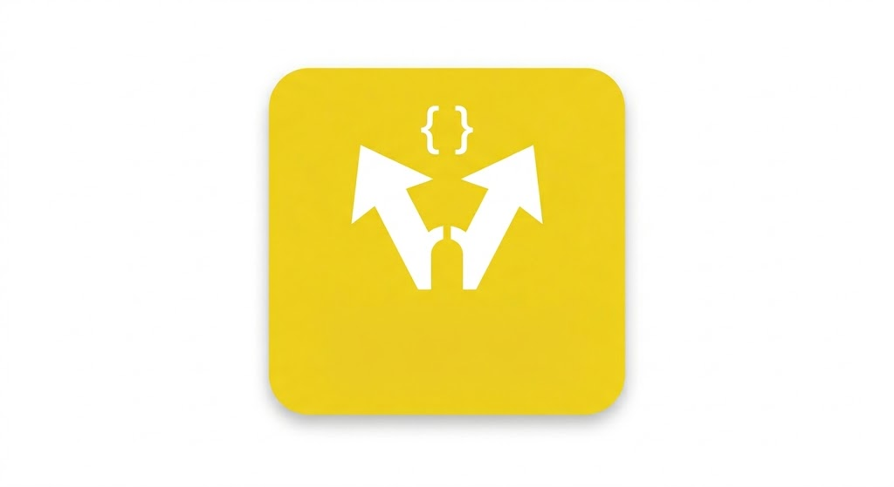

<p align="center">
  
</p>

<h1 align="center">Vula.js</h1>

<p align="center">
  A WebSocket server-streamed full-stack framework built on Rspack. Zero client-side app bundles by default, with live DOM &amp; Canvas streaming, file-based routing, API routes, and server components — all in one codebase.
</p>

<p align="center">
  <a href="https://www.npmjs.com/package/@swavoti/vula"></a>
  
  
  
</p>

---

## What is Vula.js?

Vula.js is a server-first full-stack web framework built around its own **WebSocket Server Streaming Engine** (`core/stream/` + `/_vula/stream/client.js`). Instead of shipping your application logic, routes, and JS chunks to the browser, Vula executes your UI and business logic on the server and streams live DOM updates (`dom-sync` / `dom-patch`) or binary frame surfaces over WebSockets (`/_vula/stream/ws`).

Your pages (`app/`), API routes (`app/api/`), server components (`*.sever.comp.ts`), and interactive stream surfaces (`*.stream.ts`) live in one codebase. Vula compiles them with **Rspack** (a Rust-based bundler) and SWC, routes them with a compact C/WASM trie, and bridges UI events and state back over authenticated single-use WebSocket sessions.

It runs on both **Deno** and **Node.js**, and lets you switch cleanly between **Global WebSocket DOM Streaming** (default) and standard client-chunk hydration via `vulaism.config.yaml`.

---

## Benefits

- **WebSocket Server Streaming (Default)** — With `streaming.enabled: true` and `streaming.global: true`, Vula strips client app bundles (`.vula.cache.js` and `/chunks/`) and streams live DOM state and patches over `/_vula/stream/ws` via `VulaStream.mountDom`, keeping UI logic, state, and proprietary code on the server.
- **Named Stream Surfaces (`*.stream.ts`)** — Mount server-rendered interactive canvas surfaces on demand with `<VulaStreamSurface />` from `@swavoti/vula/client`, streaming `"VF"` binary frame packets (`jpeg`, `png`, `rgba-deflate`, or WebCodecs `vp8`/`vp9`/`h264`/`av1`).
- **File-based routing** — Drop a `page.tsx` in `app/` and it becomes a route. No config files, no router setup.
- **API routes in the same codebase** — Write backend handlers in `app/api/`. They run on the server, right next to your UI code.
- **Server components** — Run logic on the server and get results back via `Vula.server()` (`*.sever.comp.ts`) without REST boilerplate.
- **Built-in caching** — Add `<VulaCache />` to your app and get service worker caching out of the box.
- **Security scanning** — Vula scans your code for unauthorized `<script>` tags before every build. If a script source isn't in `vula.scripts.allow.ts`, the build stops.
- **Rspack bundling** — Rust-powered builds and fast hot module replacement during development.
- **Deno and Node support** — Set `"runtime": "deno"` or `"runtime": "node"` in your `package.json` and Vula adapts.
- **SEO injection** — Viewport, OpenGraph, and meta tags are injected automatically into every HTML response.
- **Middleware** — Add a `middleware.ts` in your `app/` folder and it runs before every request.
- **Vula navigation** — `<VulaLink page="/about">` intercepts internal navigation over the active WebSocket DOM session (in Global Streaming mode) or fetches compressed route fragments on demand (when `streaming.global: false`).
- **WASM routing core** — A compact C trie (`core/wasm/vula-core.wasm`) matches static, dynamic, and catch-all page routes, paired with a C/WASM LZSS codec for route fragments.

---

## Built-in Modules

Vula comes with powerful, zero-config built-in modules you can use to power your application:

### 1. Video Optimization (`@vula/video-opti`)
A built-in middleware that utilizes FFmpeg WASM to automatically intercept video requests (`.mp4`, etc.) and seamlessly transcode them into highly optimized HLS chunks (`.m3u8` / `.ts`) on the fly, caching them for future requests.

### 2. Image Optimization (`@vula/image-opti`)
This middleware intercepts image requests and optimizes them dynamically. Simply pass query parameters to resize and reformat images instantly: ``.

### 3. WebSocket Server Streaming (`core/stream/`)
Vula replaces traditional client-heavy delivery with a custom WebSocket streaming runtime (`/_vula/stream/client.js`, `VulaStream.mountDom`, `VulaStream.mount`). In Global DOM Streaming mode (`streaming.global: true`), `core/server.js` strips `.vula.cache.js` and `/chunks/` scripts from the HTML shell, connects the page to an authenticated WebSocket (`/_vula/stream/ws`), streams `dom-sync` and incremental `dom-patch` updates keyed by `data-vid`, and forwards user events (`click`, `input`, `change`, `submit`, `popstate`) back to the server.

### 4. Font Optimization
Vula includes built-in font optimization out of the box, controlled via your `vulaism.config.yaml`.
- **Preloading**: Automatically injects `<link rel="preload">` tags for critical fonts to prevent layout shift.
- **Display Strategy**: Injects `@font-face { font-display: swap }` to ensure text is visible while fonts load.
- **Subsetting**: In production, unused glyphs can be stripped out to minimize WOFF2 file sizes.

---

## Quick Start

The easiest way to get started is with the scaffolding tool. Run this single command to instantly create a new Vula.js project:

```bash
npx create-vulajs-app my-app
```

Then install and run:

```bash
cd my-app
npm install
npm run dev
```

Your app is now running at `http://localhost:3000`.

---

## Project Structure

```
my-app/
├── app/
│   ├── page.tsx                   # Home page (/)
│   ├── about/
│   │   └── page.tsx               # About page (/about)
│   ├── layout.tsx                 # Shared layout
│   ├── studio.stream.ts           # Named server-only Canvas stream surface
│   ├── api/
│   │   ├── hello.ts               # API route (GET /api/hello)
│   │   └── counter.sever.comp.ts  # Server component
│   └── middleware.ts              # Runs before every request
├── src/
│   ├── index.tsx                  # Client bootstrap (bootstrapVula from @swavoti/vula/client)
│   ├── globals.css                # Global styles
│   ├── cache.tsx                  # VulaCache component
│   └── vula.ts                    # Re-exports @swavoti/vula/client
├── public/
│   └── vula-sw.js                 # Service worker for caching
├── core/
│   ├── server.js                  # Express server + SSR shell + WS upgrade wiring
│   ├── config.js                  # vulaism.config.yaml loader & streaming resolver
│   ├── client/                    # @swavoti/vula/client SDK (VulaLink, VulaStreamSurface, bootstrapVula)
│   ├── stream/                    # WebSocket Global DOM & Canvas frame stream engine
│   ├── wasm/                      # C/WASM routing trie & LZSS codec
│   └── router/
│       └── manifest.js            # Route & streamSurface manifest generator
├── bin/
│   └── vula.js                    # CLI (vula dev, vula build, vula start, vula upgrade-check)
├── vulaism.config.yaml            # Master app, security, optimization, and streaming config
├── vula.scripts.allow.ts          # Security allow list
├── rspack.config.js               # Rspack bundler config
├── deploy.md                      # Production deployment modes guide
├── troubleshooting.md             # Common runtime & streaming diagnostics
├── tsconfig.json                  # TypeScript config
├── deno.json                      # Deno config
└── package.json
```

---

# Documentation

## Pages

Any file named `page.tsx` (or `page.jsx`) inside the `app/` directory becomes a route.

> [!WARNING]
> Because Vula uses absolute file-based routing based on folder names, users must be very careful when writing and naming routes to avoid collisions or unexpected behavior.

| File | Route |
|---|---|
| `app/page.tsx` | `/` |
| `app/about/page.tsx` | `/about` |
| `app/blog/page.tsx` | `/blog` |
| `app/blog/post/page.tsx` | `/blog/post` |

### Example

```tsx
// app/page.tsx
import { VulaLink } from '../src/vula';

export default function Home() {
  return (
    <div>
      <h1>Home Page</h1>
      <p>Edit this file and the browser updates instantly.</p>
      <VulaLink page="/about">Go to About</VulaLink>
    </div>
  );
}
```

Vula scans `app/` on startup and generates a private server manifest (`.vula-routes.json`) plus a browser-safe route manifest (`.vula-routes.client.json`). The browser manifest contains only page URL patterns and client page paths; API handlers, server-component paths, and middleware paths stay in the server manifest. On initial load, only the matching page's client chunk is loaded.

### Navigation (Linking Between Pages)

Use Vula's link component for internal navigation:

```tsx
<VulaLink page="/settings">Settings</VulaLink>
```

`page` is the public URL path, including dynamic destinations such as `/users/42`. The component renders an accessible anchor, intercepts ordinary same-origin clicks, requests the destination's server-rendered page, and hydrates it in place. The shared layout stays mounted; Vula loads only the destination page's client chunk. Modifier-clicks, downloads, external links, and unsupported routes keep normal browser navigation behavior.

Vula compiles static, dynamic (`[id]`), and catch-all (`[...rest]`) page paths into a compact C routing trie and ships it as `core/wasm/vula-core.wasm`. The server uses this trie for both initial page matching and client navigation requests. The browser loads the same small WASM module when Vula navigation is first used; initial hydration takes the matched route index from the server-rendered document and does not need to fetch the WASM module.

Navigation responses are buffered until server rendering completes, then compressed with the C/WASM LZSS codec when the compressed result is smaller. Pages larger than the codec's 256 KiB input limit are sent uncompressed. Compression is lossless transport compression—not encryption—and does not hide route data from users. The navigation endpoint buffers each page before responding, so it does not progressively stream HTML chunks.

Rebuild the checked-in WASM binary after changing its C sources with `npm run build:wasm`. This requires Clang with a WebAssembly target and `wasm-ld`.

This first page-fragment flow is not React Server Components/Flight. The initial route uses normal root hydration; navigated pages use a separate hydration root, so React context providers from the layout are not inherited by a navigated page yet. Apps that depend on layout-provided context should use a regular anchor for those transitions until Vula's Flight-based rendering is implemented. Vula's existing `.sever.comp` RPC feature remains separate.

In development, Vula warns in the browser console when internal navigation bypasses `VulaLink` (including ordinary internal anchors and history-based routers). In production, the `.vula.cache.js` entry is minified; minification is not obfuscation or a security boundary. Browser-delivered page code and route URLs are always inspectable. API handlers remain server-side, but API endpoints are reachable by clients and must enforce authorization themselves.

---

## API Routes

Any `.ts` or `.js` file inside `app/api/` becomes an API endpoint. Export named functions for each HTTP method you want to handle.

| File | Endpoint |
|---|---|
| `app/api/hello.ts` | `/api/hello` |
| `app/api/users/index.ts` | `/api/users` |
| `app/api/users/profile.ts` | `/api/users/profile` |

### Supported Methods

Export any of these: `GET`, `POST`, `PUT`, `DELETE`, `PATCH`.

### Example

```ts
// app/api/hello.ts

export async function GET(req, res) {
  res.json({
    status: "ok",
    message: "Hello from your API",
    timestamp: new Date().toISOString(),
  });
}

export async function POST(req, res) {
  const body = req.body;
  res.json({ received: body });
}
```

API route handlers receive standard Express `req` and `res` objects. They run on the server only — they are never bundled into the client.

### Calling API Routes from the Frontend

Use the `Vula.api()` helper (exported from `@swavoti/vula/client` and re-exported by `src/vula.ts`):

```tsx
import { Vula } from '@swavoti/vula/client';

// Short form — automatically prefixes with /api/
const data = await Vula.api('hello');

// Full path
const data = await Vula.api('/api/hello');

// POST with body
const data = await Vula.api('hello', {
  method: 'POST',
  headers: { 'Content-Type': 'application/json' },
  body: JSON.stringify({ name: 'Vula' }),
});
```

---

## Server Components

Server components let you run logic on the server and get the result back on the client — without writing a full API route. They're useful for database queries, file access, or anything that shouldn't run in the browser.

### Naming Convention

Server component files use the extension `.sever.comp.ts` (or `.js`).

| File | Component Name |
|---|---|
| `app/api/counter.sever.comp.ts` | `api/counter` |
| `app/auth/verify.sever.comp.ts` | `auth/verify` |

### Writing a Server Component

Export a default async function:

```ts
// app/api/counter.sever.comp.ts

export default async function counter(currentValue: number) {
  return currentValue + 1;
}
```

### Calling from the Frontend

Use `Vula.server()`:

```tsx
import { Vula } from '@swavoti/vula/client';

const newCount = await Vula.server('api/counter', 5);
// Returns: 6
```

The client bridge sends the arguments to the server via `POST /_vula/server-component`, the server runs the function, and returns the result as JSON.

---

## WebSocket Server Streaming (Global DOM & Canvas Surfaces)

Vula streams interactive applications and isolated UI surfaces from the server over **WebSockets (`/_vula/stream/ws`)** — keeping page bundles, application state, and proprietary business logic off the client.

> **WebRTC Removed:** Vula no longer uses WebRTC peer connections as its streaming mechanism. All streaming (`__global__` DOM streaming and `*.stream.*` canvas surfaces) runs over authenticated WebSocket sessions (`/_vula/stream/ws`) via `/_vula/stream/client.js`. Legacy `experimental.webrtc-stream*` config keys are mapped automatically to `streaming.*` in `core/config.js`.

### 1. Configure `vulaism.config.yaml`

Streaming is enabled globally out of the box:

```yaml
streaming:
  enabled: true              # Enable WebSocket server streaming (or "--global")
  global: true               # Stream all pages as __global__ DOM sessions with zero client JS chunks
  quality: "hd"              # Stream quality preset
  codec: "vp8"               # "vp8" | "vp9" | "h264" | "av1" (for canvas surface frame encoding)
  fps: 30
  max-width: 1920
  max-height: 1080
  idle-timeout-ms: 60000
  allow-console-logs: false  # Forward server surface console output to the browser console
  dynamic-loading: true      # Defer off-screen / non-critical content loading
```

You can also force Global DOM Streaming from the CLI or environment with `vula dev --global` or `VULA_STREAM_GLOBAL=1`.

### 2. How Global DOM Streaming Works (`streaming.global: true`)

When Global DOM Streaming is active, browsers receive zero client application JS chunks:

1. **Lean HTML Shell:** `core/server.js` renders the route on the server with `bootstrapScripts: []`, strips `.vula.cache.js` and `/chunks/` `<script>` tags, marks `#root` with `data-vula-dom="incoming"`, and injects `/_vula/stream/client.js` calling `window.VulaStream.mountDom(document.getElementById('root'), { surface: '__global__', path })`.
2. **Ticket & WebSocket Handshake:** `VulaStream.mountDom` mints an HMAC-SHA256 signed, single-use ticket via `POST /_vula/stream/ticket` (protected by Vula's CSRF rules) and opens `WebSocket /_vula/stream/ws?ticket=...`.
3. **Server Session (`createGlobalPageSurface`):** The server runs the `__global__` surface session (using headless Chrome/Chromium/Brave CDP DOM bridging via `createCdpDomSession` when available, or SSR + interactive fallback via `SurfaceBuffer`). Early user clicks/inputs during `data-vula-dom="incoming"` are queued locally until the WebSocket handshake completes.
4. **Live DOM Morphing & Event Forwarding:** The server pushes `dom-sync` snapshots and incremental `dom-patch` updates keyed by `data-vid`. `mountDom` morphs the live DOM in place (`morphChildren`), synchronizes URL history (`popstate` / `VulaLink`), and sends user interactions (`click`, `input`, `change`, `submit`) back to the server as `dom-event` messages.

### 3. Named Canvas Stream Surfaces (`*.stream.ts`)

For isolated server-only canvas views (or when `streaming.global: false` and `streaming.enabled: true`), files matching `*.stream.ts`, `*.stream.js`, `*.stream.comp.ts`, or `*.stream.comp.js` in `app/` are registered into `streamSurfaces` in `.vula-routes.json` and excluded from `.vula-routes.client.json`:

```ts
// app/studio.stream.ts
export const isPublic = true; // or export async function authorize(req) { ... }

export default function createStudioSurface(ctx) {
  let clicks = 0;

  return {
    onInput(event) {
      if (event.type === 'pointerdown') {
        clicks += 1;
        ctx.pushControl({ type: 'cursor', cursor: 'pointer' });
        ctx.pushControl({ type: 'nav', path: `/studio?clicks=${clicks}` });
      }
    },
    render(buf) {
      buf.clear('#0f172a');
      buf.drawText(`SERVER CLICKS: ${clicks}`, 24, 24, '#ffffff', 3);
    },
  };
}
```

Mount a named surface anywhere with `<VulaStreamSurface />`:

```tsx
import { VulaStreamSurface } from '@swavoti/vula/client';

export default function StudioPage() {
  return <VulaStreamSurface surface="studio" style={{ height: '70vh' }} />;
}
```

### Under the Hood

- **Security & Auth:** Ticket minting (`POST /_vula/stream/ticket`) enforces CSRF validation, single-use ticket consumption (`consumeTicketOnce`), and the same `authorize(req)` / `isPublic` rules as server components. Tickets are HMAC-SHA256 signed and time-bounded.
- **Binary Frame Protocol (`"VF"`):** Canvas surfaces stream a 28-byte `"VF"` binary header over `/_vula/stream/ws`, supporting `jpeg`, `png`, zlib `rgba-deflate` (decoded via `DecompressionStream`), and WebCodecs (`vp8`, `vp9`, `h264`, `av1` via `VideoDecoder`).
- **UX Sync & Idle Pause:** Syncs native OS cursors, scroll position (`scroll` / `scroll-to`), `history.pushState`/`popstate`, a positioned `<input>` overlay for desktop/mobile typing, optional `console` control forwarding, and pauses rendering when `document.hidden` is true. Set `VULA_STREAM_BROWSER` to specify a Chromium/Chrome/Brave binary path for CDP rendering, or `VULA_STREAM_WARMUP=1` to pre-launch it on startup.

---

## Middleware

Create a `middleware.ts` (or `.js`) in the root of your `app/` directory. It runs before every incoming request.

```ts
// app/middleware.ts

export default function middleware(req, res, next) {
  console.log(`${req.method} ${req.url}`);
  next();
}
```

Common uses:
- Request logging
- Authentication checks
- CORS headers
- Rate limiting

The middleware receives standard Express `req`, `res`, and `next` arguments.

---

## Caching (Service Worker)

Vula includes a built-in service worker for asset caching. Add the `<VulaCache />` component anywhere in your app to enable it.

```tsx
import { VulaCache } from '../src/cache';

export default function Layout() {
  return (
    <div>
      <VulaCache />
      {/* your content */}
    </div>
  );
}
```

### How It Works

- On first load, the service worker caches your HTML and JS bundles.
- On subsequent visits, assets are served from cache first, then updated in the background.
- API routes (`/api/*`) and server component calls (`/_vula/*`) are **never cached** — they always hit the server.
- When you deploy a new version, old caches are automatically cleaned up.

The service worker lives at `public/vula-sw.js`. You can customize it if you need different caching strategies.

---

## Security (Script Allow List)

Vula scans all `.tsx` and `.jsx` files in `app/` for `<script>` tags before every `dev` and `build` run. If a script source isn't listed in `vula.scripts.allow.ts`, the process exits with an error.

### The Allow List

```ts
// vula.scripts.allow.ts

export const ALLOWED_SCRIPTS: string[] = [
  "https://fonts.googleapis.com",
  "https://www.googletagmanager.com/gtag/js",
];
```

### What Happens on Violation

```
[vula] BLOCKED: Unverified script in page.tsx: https://evil.com/inject.js
[vula] Add it to vula.scripts.allow.ts or remove it.
```

The build stops. Your users' browsers are protected.

---

## SEO

Vula automatically injects meta tags into every HTML response served by the dev server and production server:

```html
<meta name="generator" content="vula-1.0.3" />
<meta property="og:type" content="website" />
<meta name="viewport" content="width=device-width, initial-scale=1" />
```

For page-specific SEO (title, description, og:image), set them in your `page.tsx` using standard `<head>` elements or a `<Helmet>`-style library.

---

## CLI Reference

| Command | Description |
|---|---|
| `vula dev` | Start the development server on port 3000 |
| `vula dev --global` | Start the dev server with Global WebSocket DOM Streaming forced on |
| `vula build` | Build production assets and server chunks into `.swvula/` |
| `vula start` | Start the production server from `.swvula/` |
| `vula upgrade-check` | Check npm for newer versions of `@swavoti/vula` |
| `vula help` | Print CLI usage information |

### `vula dev`

1. Runs security checks (script allow list)
2. Runs ESLint (if installed)
3. Generates the route manifests (`.vula-routes.json` and `.vula-routes.client.json`)
4. Starts the Express server (`core/server.js`) with Rspack dev middleware and WebSocket streaming upgrade handling (`/_vula/stream/ws`)

### `vula build`

1. Runs security checks
2. Runs ESLint
3. Generates the route manifests
4. Runs `rspack build` to produce production bundles in `.swvula/`

### `vula start`

Starts the production server from the prebuilt `.swvula/` output (see [deploy.md](file:///home/ngudoliswoga/vulajs/deploy.md)).

---

## Runtime Configuration

Set the runtime in your `package.json`:

```json
{
  "runtime": "deno"
}
```

| Value | Behavior |
|---|---|
| `"deno"` | Uses Deno to run Rspack CLI commands |
| `"node"` (default) | Uses npx to run Rspack CLI commands |

Both runtimes use the same codebase, the same `app/` directory, and the same API route handlers.

---

## Configuration Files

### `rspack.config.js`

Standard Rspack configuration. Vula sets up SWC for TypeScript/JSX, CSS handling, React Refresh for HMR, and the `@app` alias for the `app/` directory.

### `tsconfig.json`

TypeScript config with `react-jsx` transform, path aliases, and type references.

### `deno.json`

Deno-specific config for JSX support and `node_modules` directory mode.

### `vulaism.config.yaml`

The master configuration file for your Vula application. If omitted, safe defaults are applied.

```yaml
app:
  name: "My Vula App"
  icon: "assets/icon.png"  # Auto-injected as favicon
  lang: "en"

optimization:
  text-opt: true           # Compression hint headers
  font-preload: true       # Injects <style>@font-face { font-display: swap }</style>
  font-display: "swap"
  image-compression: true

security:
  csrf: true               # Origin validation for POST/PUT/DELETE
  allowed-origins: []      # Whitelist for CSRF
  content-security-policy: false

proxy:
  enabled: false           # Activate built-in proxy (e.g. for a Go/Python backend)
  target: "http://localhost:8080"
  prefix: "/proxy"

server:
  port: 3000
  trust-proxy: false       # Set true if deployed behind Nginx/Cloudflare

streaming:
  enabled: true            # Enable WebSocket server streaming (or "--global")
  global: true             # Stream all pages as __global__ DOM sessions (no client JS chunks)
  quality: "hd"            # Surface encoding preset
  codec: "vp8"             # "vp8" | "vp9" | "h264" | "av1"
  fps: 30
  max-width: 1920
  max-height: 1080
  idle-timeout-ms: 60000
  allow-console-logs: false
  dynamic-loading: true
```

---

## Customizing HTML Template

Vula.js uses an `index.html` file as a template for your application. By default, it looks for this file in the **root** of your project.

### Automatic Script Injection

You **do not** need to manually add `<script>` tags to your `index.html`. Rspack automatically detects all entry points (like `src/index.tsx`) and injects the necessary `<script>` and `<link>` tags for you during the build process.

```html
<!-- index.html (Project Root) -->
<!DOCTYPE html>
<html lang="en">
<head>
    <meta charset="UTF-8">
    <title>My Vula App</title>
</head>
<body>
    <div id="root"></div>
    <!-- No manual script tags needed! -->
</body>
</html>
```

### Why avoid `public/index.html`?

If you place an `index.html` file inside the `public/` directory, it will be served as a raw static file. Because it hasn't been processed by Rspack, it will **not** have the automatic script injections, which usually results in a blank page.

Always keep your template in the project root and let Vula.js handle the injection for you.

---

## TypeScript in Vula

Vula uses TypeScript everywhere. Here's what you need to know.

### Pages

Pages are `.tsx` files. They export a default React component. No special types needed:

```tsx
// app/dashboard/page.tsx
export default function Dashboard() {
  return <h1>Dashboard</h1>;
}
```

### API Route Types

API handlers receive Express `Request` and `Response` objects. Import the types:

```ts
// app/api/users.ts
import type { Request, Response } from 'express';

export async function GET(req: Request, res: Response) {
  const users = [{ id: 1, name: "Alice" }];
  res.json(users);
}

export async function POST(req: Request, res: Response) {
  const { name } = req.body;
  // save to database...
  res.status(201).json({ id: 2, name });
}
```

### Server Component Types

Server components are just functions. Type them however you want:

```ts
// app/api/math.sever.comp.ts
interface CalcInput {
  a: number;
  b: number;
  op: 'add' | 'subtract' | 'multiply';
}

export default async function calculate(input: CalcInput): Promise<number> {
  switch (input.op) {
    case 'add': return input.a + input.b;
    case 'subtract': return input.a - input.b;
    case 'multiply': return input.a * input.b;
  }
}
```

---

## Environment Variables

Vula uses `dotenv` to load variables from a `.env` file in your project root.

### Setup

Create a `.env` file:

```
DATABASE_URL=postgres://localhost:5432/mydb
API_SECRET=supersecretkey123
PUBLIC_APP_NAME=My Vula App
```

### Usage in API Routes

```ts
// app/api/db.ts
import type { Request, Response } from 'express';

export async function GET(req: Request, res: Response) {
  const dbUrl = process.env.DATABASE_URL;
  // use dbUrl to connect...
  res.json({ connected: true });
}
```

### Security

Environment variables are **server-only**. They are available in:
- API routes (`app/api/*.ts`)
- Server components (`*.sever.comp.ts`)
- Middleware (`app/middleware.ts`)

They are **never** sent to the browser. The Rspack bundler only bundles what's in `src/` and `app/page.tsx` files — it does not have access to `process.env` at build time unless you explicitly configure it.

---

## Error Handling

### API Routes

Vula wraps every API handler in a try/catch. If your handler throws, the server responds with `500 Internal Server Error` and logs the error:

```ts
export async function GET(req: Request, res: Response) {
  throw new Error("Something broke");
  // Client receives: { "error": "Internal Server Error" }
  // Server logs the full stack trace
}
```

To return custom errors:

```ts
export async function GET(req: Request, res: Response) {
  const user = await findUser(req.query.id);
  if (!user) {
    return res.status(404).json({ error: "User not found" });
  }
  res.json(user);
}
```

### Server Components

If a server component throws, the client bridge (`Vula.server()`) rejects with an error:

```tsx
try {
  const result = await Vula.server('api/riskyAction', data);
} catch (err) {
  // err.message = "Server component execution failed"
  console.error(err);
}
```

### Client-Side Errors

For React rendering errors, use standard React error boundaries:

```tsx
// app/error-boundary.tsx
import React from 'react';

export class ErrorBoundary extends React.Component<
  { children: React.ReactNode },
  { hasError: boolean }
> {
  state = { hasError: false };

  static getDerivedStateFromError() {
    return { hasError: true };
  }

  render() {
    if (this.state.hasError) {
      return <div>Something went wrong.</div>;
    }
    return this.props.children;
  }
}
```

---

## Deployment

### Build for Production

```bash
vula build
```

This produces a `.swvula/` directory containing your built production server chunks and static assets.

### Run in Production

Start the production server with:

```bash
npx vula start
```

Or directly via Node:

```bash
NODE_ENV=production node bin/vula.js start
```

In production mode (`vula start`), the server serves from `.swvula/` without running Rspack dev middleware. See [deploy.md](file:///home/ngudoliswoga/vulajs/deploy.md) for details on deploying in **Global WebSocket DOM Streaming mode** (`streaming.enabled: true`, `streaming.global: true`) vs **Standard SSR + Client Chunk mode**, and [troubleshooting.md](file:///home/ngudoliswoga/vulajs/troubleshooting.md) for diagnostics.

### Docker

```dockerfile
FROM node:20-alpine

WORKDIR /app
COPY . .
RUN npm install
RUN npx vula build

ENV NODE_ENV=production
EXPOSE 3000
CMD ["npx", "vula", "start"]
```

### Platform Support

Vula runs anywhere Node.js or Deno runs:
- Linux servers
- Docker containers
- Vercel (with custom server adapter)
- Railway, Render, Fly.io
- Any VPS

---

## How the Bridge Works (Architecture)

Understanding how Vula connects the browser and server across its two operating modes:

### 1. Global WebSocket Streaming Mode (`streaming.enabled: true`, `streaming.global: true` — Default)

```
Browser (Thin Client Shell)              Server (Node/Deno + core/stream/)
───────────────────────────              ─────────────────────────────────
GET /                              ───►  core/server.js SSR HTML shell
                                         (bootstrapScripts: [], strips .vula.cache.js & /chunks/)
/_vula/stream/client.js
  POST /_vula/stream/ticket        ───►  CSRF + auth check → HMAC-SHA256 ticket
  WS /_vula/stream/ws?ticket=...   ◄──►  createGlobalPageSurface (__global__)
    ◄── dom-sync / dom-patch (data-vid)    ├── createCdpDomSession (CDP DOM bridge)
    ──► dom-event / popstate               └── SurfaceBuffer SSR fallback
    ◄── control (nav / scroll / cursor)
```

In this default mode, **zero application JS chunks (`.vula.cache.js`, `/chunks/*`) are sent to the browser**. `/_vula/stream/client.js` calls `VulaStream.mountDom` on `#root`, queues any interactions while `data-vula-dom="incoming"`, morphs incoming `dom-sync`/`dom-patch` payloads directly into the DOM, and forwards DOM events back over the WebSocket.

Named canvas surfaces (`*.stream.ts`) can also be embedded via `[data-vula-stream]` / `<VulaStreamSurface />`, streaming `"VF"` binary frame packets (`jpeg`, `png`, `rgba-deflate`, or WebCodecs `vp8`/`vp9`/`h264`/`av1`).

### 2. Standard Opt-Out Mode (`streaming.global: false`)

When you set `streaming.global: false` (or `streaming.enabled: false`), Vula delivers standard SSR HTML paired with per-route client chunks:

```
Browser (Client)                    Server (Node/Deno)
────────────────                    ──────────────────
app/page.tsx          ──build──►    .swvula/ (bundled per-page chunks)
@swavoti/vula/client  ──build──►    VulaLink, Vula.api(), Vula.server(), VulaStreamSurface

                      ──HTTP──►
Vula.api('hello')     ─────────►    app/api/hello.ts (runs here)
Vula.server('x', 5)   ─────────►    app/api/x.sever.comp.ts (runs here)

app/middleware.ts                   (runs on every request)
```

- **Pages** (`page.tsx`) render server-side HTML on initial load and hydrate from per-page client chunks (`.vula.cache.js` + `/chunks/`).
- **API routes** (`app/api/*.ts`) and **Server components** (`*.sever.comp.ts`) always execute exclusively on the Express server.
- **Manifests**: `.vula-routes.json` stays private on the server (mapping pages, APIs, server components, middleware, and `streamSurfaces`), while `.vula-routes.client.json` exposes only public page routes needed for WASM navigation.

---

## Comparison with Next.js

| Feature | Next.js | Vula.js |
|---|---|---|
| Delivery Model | Client JS hydration + RSC | WebSocket Server DOM & Canvas Streaming (zero client app JS by default) |
| Bundler | Webpack / Turbopack | Rspack (Rust) |
| Runtime | Node.js only | Deno + Node.js |
| Routing | File-based (`app/`) + C/JS router | File-based (`app/`) + C/WASM trie |
| API Routes | `route.ts` with Web API | `hello.ts` with Express API |
| Server Components | React Server Components | `.sever.comp.ts` + `*.stream.ts` |
| Caching | ISR / revalidate | Service Worker (client) |
| Security | None built-in | Script allow list + single-use WS stream tickets |
| Middleware | `middleware.ts` | `middleware.ts` |
| Config | `next.config.js` | `vulaism.config.yaml` + `rspack.config.js` |
| Package size | ~300MB node_modules | ~100MB node_modules |

---

## FAQ

### Do I need Deno?

No. Set `"runtime": "node"` in your `package.json` and use `npm install` + `npx vula dev`. Deno is optional but recommended for its security model and native TypeScript support.

### Can I use a database?

Yes. API routes, server components, and `.stream.ts` surfaces run on the server with full Node.js/Deno API access. Use any database driver: Prisma, Drizzle, pg, mongoose, etc.

### Can I use Tailwind CSS?

Yes. Install Tailwind and `postcss-loader`, then update the CSS rule in `rspack.config.js` to use `postcss-loader` with the Tailwind plugin.

### Where do static files go?

Put them in `public/`. They're served at the root URL. Example: `public/logo.png` → `http://localhost:3000/logo.png`.

### Can I deploy to Vercel?

Vula uses Express and persistent WebSockets (`/_vula/stream/ws`) for streaming, so deploy it as a standalone Node/Deno server (Docker, Railway, Fly.io, Render, VPS) or use an adapter if opting out of WebSocket streaming.

### How do I add authentication?

Use `app/middleware.ts` to check auth tokens on every request, or export `authorize(req)` / `isPublic` inside individual server components and `*.stream.ts` surfaces (also enforced when minting `/_vula/stream/ticket`).

### How does UI authoring work with WebSocket streaming?

You author your pages (`app/**/page.tsx`) in familiar JSX/TSX and server surfaces (`*.stream.ts`) in TypeScript/JavaScript. With `streaming.global: true`, Vula runs them on the server and streams DOM patches over WebSockets instead of shipping client JS bundles; if you need client-side libraries (such as browser animation hooks or client state), set `streaming.global: false` in `vulaism.config.yaml` (and optionally mount server-only `<VulaStreamSurface />` views selectively).

---

## Troubleshooting

See [troubleshooting.md](file:///home/ngudoliswoga/vulajs/troubleshooting.md) for streaming, build, and runtime diagnostics.

### JSX Type Errors in Deno
If you see errors like `JSX element implicitly has type 'any'` or `no interface 'JSX.IntrinsicElements' exists` while using Deno, it means the Deno language server is struggling with strict types for JSX.

**Solution**: Add `"strict": false` to your `deno.json` or `tsconfig.json`:

```json
{
  "compilerOptions": {
    "jsx": "react-jsx",
    "jsxImportSource": "react",
    "strict": false
  }
}
```

### Security Patch: React 19.2.6
If enabling client-chunk delivery (`streaming.global: false`), we recommend **React 19.2.6** or higher so client dependencies include upstream security fixes. Vula.js defaults to 19.2.6 for new projects.

---

## Contributing

1. Fork the repo
2. Create a branch: `git checkout -b feature/my-feature`
3. Make your changes
4. Test: `npm test` and `vula dev`
5. Push and open a PR

---

## License

MIT © [Swavoti](https://github.com/swavoti/vulajs)

---

**Swavoti** is a trademark and its assets are a trademark of **Swavoti South Africa Pty Ltd**.
